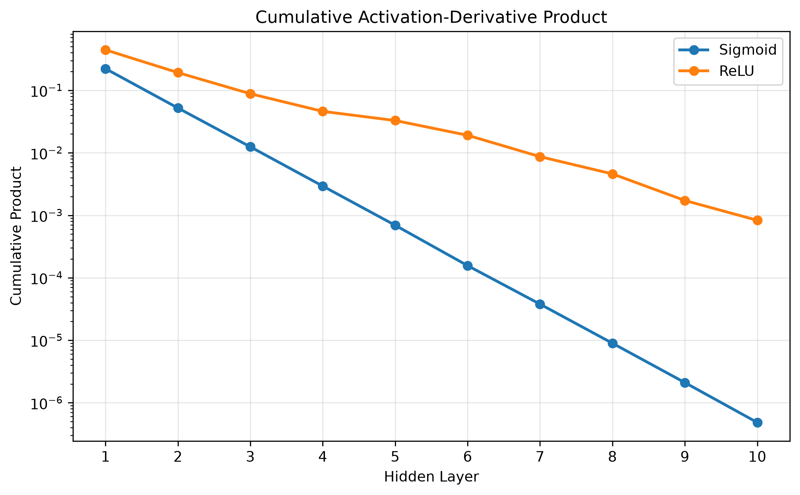
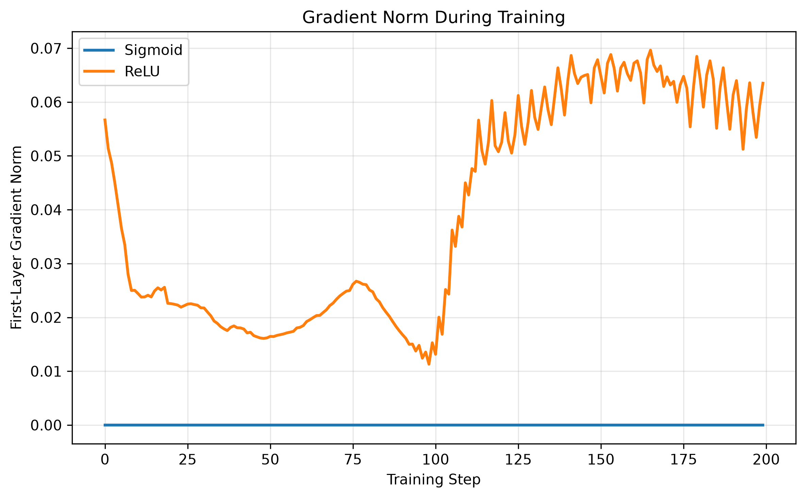
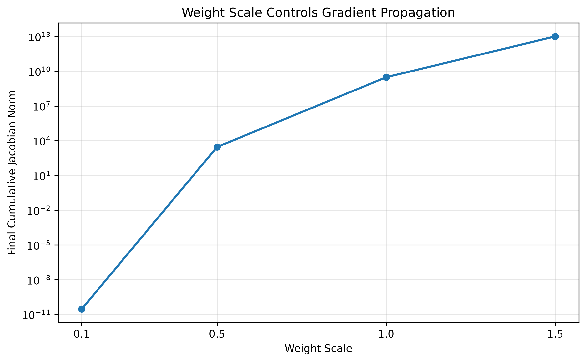

# MATH 3700 Project: From Chain Rule to Gradient Vanishing

**Author:** Shimo Wang  
**Course:** MATH 3700 - Big Data Computing   

##  Project Overview
This project investigates how the multivariate **Chain Rule** in backpropagation leads to the vanishing and exploding gradient problems in deep neural networks. By analyzing the product of layer-wise Jacobians, we demonstrate why activation function choice (Sigmoid vs. ReLU) and weight initialization are critical for numerical stability.

##  Mathematical Mainline

The backpropagated gradient for an \(L\)-layer network is a product of per-layer Jacobians:

$$
\frac{\partial \mathcal{L}}{\partial W_1} = \frac{\partial \mathcal{L}}{\partial h_L}\prod_{k=2}^{L}\frac{\partial h_k}{\partial h_{k-1}}\frac{\partial h_1}{\partial W_1}
$$

By the sub-multiplicative property of spectral norms, this implies:

$$
\left\| \prod_{k=1}^{L} J_k \right\|_2 \le \prod_{k=1}^{L} \|D_k\|_2 \|W_k\|_2
$$

**Conditions:**
- If \(\|J_k\|_2 < 1\) for all \(k\), the product decays geometrically \(\Rightarrow\) **Vanishing Gradients**.
- If \(\|J_k\|_2 > 1\) for all \(k\), the product grows exponentially \(\Rightarrow\) **Exploding Gradients**.
- 
##  Experimental Setup
- **Dataset:** Synthetic `make_moons` dataset (500 samples, 2 features).
- **Network:** Fully connected feed-forward network with **10 hidden layers** (16 neurons each).
- **Task:** Binary classification using MSE Loss and vanilla Gradient Descent.
- **Tools:** Pure Python (NumPy, Matplotlib, Scikit-learn).

##  Key Results

### 1. Vanishing Gradients (Sigmoid vs. ReLU)
Sigmoid's derivative is bounded by 0.25, causing exponential decay over 10 layers (Dead Neurons). ReLU's derivative is \(\{0, 1\}\), which preserves the gradient signal.

### 2. Depth Effect & Exploding Gradients
As network depth increases, Sigmoid fails to learn (loss plateaus at 0.25). Furthermore, scaling weights too large (e.g., Scale=1.5) causes the cumulative Jacobian norm to explode to \(10^{13}\) over 20 layers.

##  Repository Structure
- `project.ipynb`: The main Jupyter Notebook containing all code for data generation, forward/backward propagation, gradient checking, and training experiments.
- `figures/`: Generated plots used in the poster and this README.

##  How to Run
1. Clone this repository.
2. Ensure you have `numpy`, `matplotlib`, and `scikit-learn` installed.
3. Open `project.ipynb` and run all cells.
